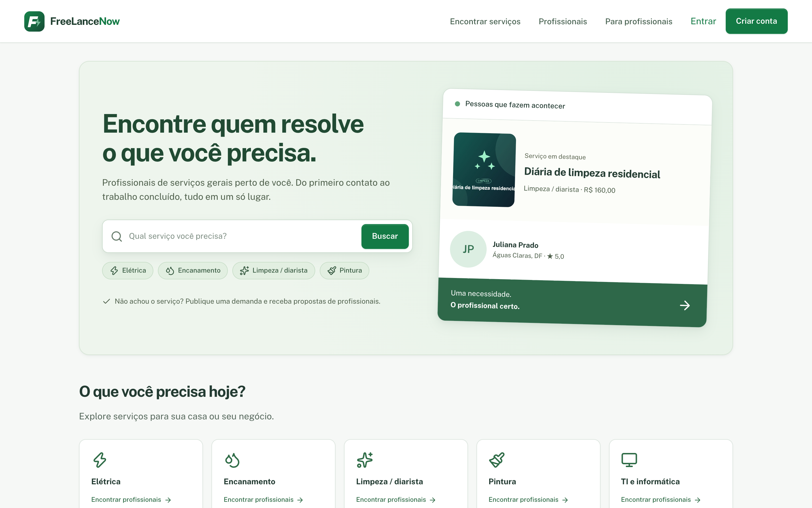
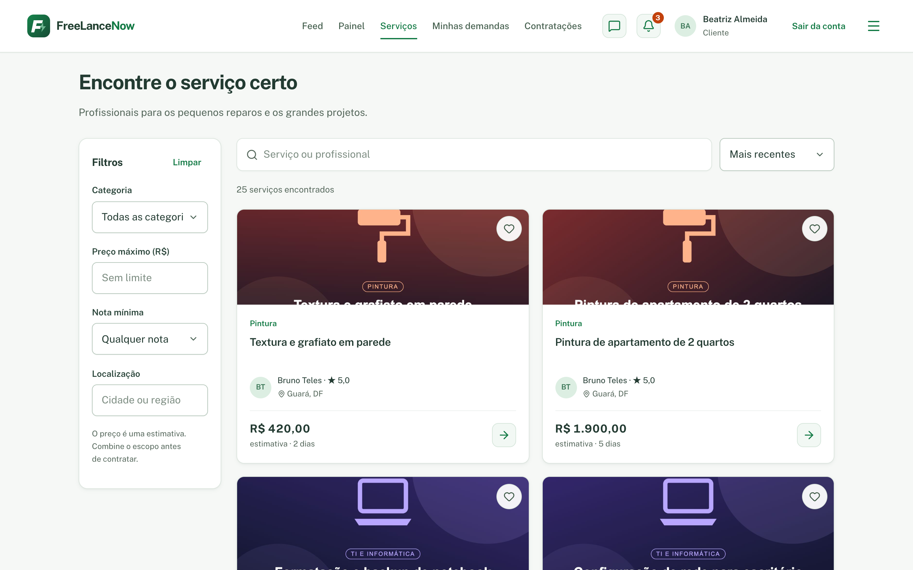
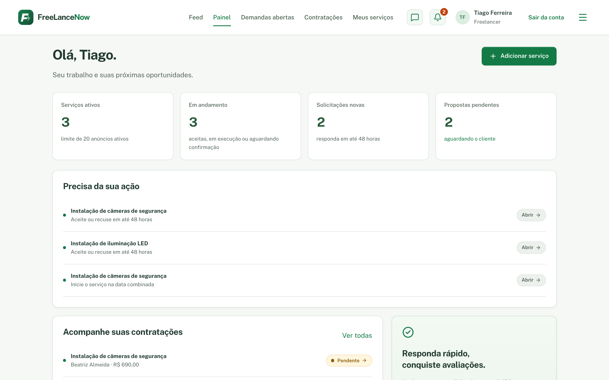

# Documentação do FreeLanceNow

## Integrantes

Soluções Computacionais — 2026/2. Integrantes em ordem alfabética.

| Nome completo | Matrícula | Turma |
|---|---|---|
| Arthur Almirante Simões | UC23102609 | GPE17M80586 |
| Arthur de Oliveira Sousa | UC23101199 | GPE17M80586 |
| Caio Rafael Alves de Sousa | UC23100468 | GPE17M80586 |
| Enzo Freitas Lima | UC23102171 | GPE17M80586 |
| Fábio Luiz Cardoso Laranjeira Rocha | UC23101369 | GPE17M80586 |
| Felipe Alves Muniz | UC23101331 | GPE17M80586 |

## Vídeo de apresentação

[Vídeo de apresentação do FreeLanceNow no YouTube](https://youtu.be/iwa1Ra2eZoY)

## Acesso para avaliação

A versão publicada está em https://freelancenow.vercel.app e já tem dados de demonstração: serviços com imagens, contratações em todas as etapas, avaliações, demandas com propostas, pagamentos em modo de teste, posts, denúncias e avisos.

| Perfil | E-mail | Senha |
|---|---|---|
| Cliente | `cliente@demo.freelancenow.test` | `Avaliacao2026` |
| Freelancer | `freelancer@demo.freelancenow.test` | `Avaliacao2026` |
| Administrador | `admin@demo.freelancenow.test` | `Avaliacao2026` |

A API fica no plano gratuito do Render e hiberna sem uso, então o primeiro acesso pode levar até 1 minuto. Os pagamentos usam o modo de teste do Stripe: use o cartão `4242 4242 4242 4242`, qualquer validade futura e qualquer CVC. Nenhuma cobrança é real.

O que explorar com cada conta e a lista das outras contas: [contas-de-acesso.md](contas-de-acesso.md).

## Executar localmente

Pré-requisitos: Git e Docker com Docker Compose. Na raiz do projeto, execute:

```sh
cp .env.example .env
docker compose up -d --build
```

Depois de 1 a 3 minutos, abra http://localhost:5173. O Compose sobe três serviços:

| Serviço | Endereço | O que faz |
|---|---|---|
| `db` | `localhost:5435` | PostgreSQL 15 com volume persistente |
| `api` | http://localhost:8081/actuator/health | API Spring Boot. Na inicialização, o Flyway aplica as migrações V1–V18 e a API carrega os dados de demonstração |
| `web` | http://localhost:5173 | Aplicação web React servida pelo Nginx, já no modo API |

Localmente, as mesmas contas usam a senha `Demo12345` (por exemplo, `cliente@demo.freelancenow.test`). Para parar, use `docker compose down`. Para apagar o banco e recomeçar do zero, use `docker compose down -v`.

Instruções completas, variáveis de ambiente e execução sem Docker: [api/README.md](../api/README.md) e [web/README.md](../web/README.md).

## Aplicações

| Pasta | Aplicação | Publicação | Como executar |
|---|---|---|---|
| `api/` | API e serviços de backend | https://freelancenow-api.onrender.com | [api/README.md](../api/README.md) |
| `web/` | Aplicação web (computador e celular) | https://freelancenow.vercel.app | [web/README.md](../web/README.md) |

O projeto não tem pastas `app/` (mobile) nem `desktop/`. O escopo definido na proposta do semestre anterior ([Documento de Arquitetura](originais/Documento%20de%20Arquitetura.docx)) prevê uma única aplicação web responsiva, usada no computador e no navegador do celular. A aplicação web consome a mesma API, que concentra as regras de negócio e as permissões dos perfis cliente, freelancer e administrador.

## Prints da solução

Telas da aplicação web com os dados de demonstração. Os arquivos ficam em [prints/](prints/).

**Página inicial:** o visitante busca um serviço ou escolhe uma categoria.



**Busca de serviços:** o cliente filtra por categoria, preço, nota e localização e compara os anúncios.



**Painel do profissional:** o freelancer acompanha serviços ativos, solicitações novas, propostas e contratações em andamento.



## Documentos da entrega

| Documento | Conteúdo |
|---|---|
| [BMC/](BMC/): [BMC.md](BMC/BMC.md) e [BMC.pdf](BMC/BMC.pdf) | Business Model Canvas atualizado (versão 2.0), com o que já funciona e o que é plano futuro |
| [DADOS/](DADOS/): [PDF](DADOS/DADOS.pdf) e [DOCX](DADOS/DADOS.docx) | Modelo de dados: diagramas entidade-relacionamento, dicionário das 21 tabelas, índices, regras de integridade e histórico de migrações |
| [Documento de Visao/](Documento%20de%20Visao/): [PDF](Documento%20de%20Visao/Documento-de-Visao.pdf) e [DOCX](Documento%20de%20Visao/Documento-de-Visao.docx) | Documento de Visão 2.0: parte da versão 1.1 dos originais, completa as seções que estavam no sumário sem conteúdo (estimativa de custo, restrições técnicas, manual de arquitetura e dicionário de dados) e atualiza o restante para o sistema entregue |
| [Documento de Arquitetura/](Documento%20de%20Arquitetura/): [PDF](Documento%20de%20Arquitetura/Documento-de-Arquitetura.pdf) e [DOCX](Documento%20de%20Arquitetura/Documento-de-Arquitetura.docx) | Documento de Arquitetura de Software 2.0: parte da versão 1.1 dos originais e cobre as visões de casos de uso, lógica, implementação, processo, implantação e dados, com diagramas atualizados, resultados de desempenho e telas do sistema entregue |
| [modelos/](modelos/) | Arquivos editáveis: fontes Mermaid e SVG dos diagramas, `bmc.html` e o gerador dos DOCX e PDF ([instruções](modelos/README.md)) |
| [originais/](originais/) | Propostas do semestre anterior: documento de visão, casos de uso, arquitetura, apresentação, pitch deck e BMC original |
| [prototipo/](prototipo/) | Protótipo navegável em HTML usado como referência visual |
| [prints/](prints/) | Três telas da solução entregue: página inicial, busca de serviços e painel do profissional |

## Guias técnicos

| Documento | Conteúdo |
|---|---|
| [contas-de-acesso.md](contas-de-acesso.md) | Contas da versão publicada e da execução local, e o que explorar com cada uma |
| [api.md](api.md) | Contrato da API: endpoints, payloads, estados, erros e autenticação |
| [requisitos.md](requisitos.md) | Regras de negócio RN01 a RN22 e onde cada uma está implementada |
| [decisoes.md](decisoes.md) | Decisões técnicas (ADR01 a ADR35) e o motivo de cada uma |
| [deploy.md](deploy.md) | Publicação na Vercel, no Render e no Neon, e-mail com Resend e pagamentos com Stripe em modo de teste |
| [testes-e-demonstracao.md](testes-e-demonstracao.md) | Comandos de teste, roteiro de demonstração, teste de carga e evidências |

Os arquivos em `originais/` e `prototipo/` são fontes históricas e não foram alterados. As fotos e os dados pessoais dos documentos acadêmicos ficam nesses originais e não representam usuários do produto.
