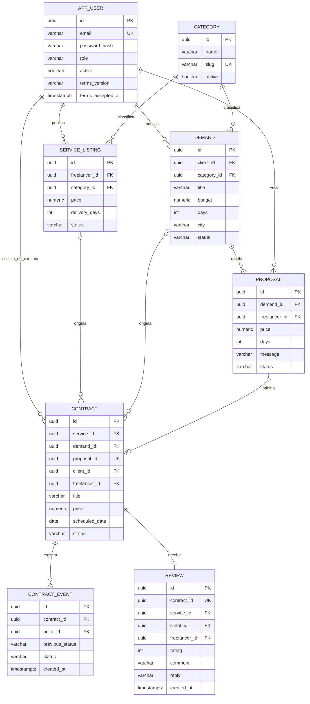

# Modelo de dados

Revisado em **21/10/2026**. Esquema implementado nas migrações `V1__initial_schema.sql`, `V2__categories.sql`, `V3__contracts.sql`, `V4__reviews.sql` e `V5__demands_and_proposals.sql`.

| Tabela | Campos e limites principais | Regras |
|---|---|---|
| `app_user` | UUID; nome 100; e-mail 254 único; hash; telefone 20; role; ativo; cidade 100; bio 600; termos/aceite; criação | E-mail em minúsculas; `CLIENT`, `FREELANCER`, `ADMIN`; hash bcrypt |
| `category` | UUID; nome; slug único; ativo | Migração cria Elétrica, Encanamento, Limpeza, TI e Pintura |
| `service_listing` | UUID; dono/categoria FK; título 80; descrição 500; preço `numeric(12,2)`; dias; status; criação | Preço >0; dias 1–365; `DRAFT`, `ACTIVE`, `INACTIVE`; dono validado pelo serviço |
| `contract` | UUID; serviço opcional/demanda opcional/proposta única opcional/cliente/freelancer FK; snapshot de título 80 e preço `numeric(12,2)`; data futura; descrição 300; endereço 200; status; observações 500; disputa 300; timestamps | Índice parcial único `(client_id, service_id) WHERE status = 'PENDENTE'`; jobs automáticos de 48h e 5 dias |
| `contract_event` | UUID; contratação FK; ator opcional FK; estado anterior/novo; nota 500; criação | Histórico imutável de transições manuais e automáticas |
| `review` | UUID; contratação única FK; serviço opcional/cliente/freelancer FK; nota 1–5; comentário 500; resposta 200; datas | Janela de 7 dias após conclusão; avaliação imutável; média de reputação com 1 casa decimal |
| `demand` | UUID; cliente/categoria FK; título 80; descrição 500; orçamento `numeric(12,2)`; dias 1–365; cidade 100; status (`OPEN`, `CLOSED`); datas | Somente clientes publicam; encerra automaticamente ao aceitar uma proposta |
| `proposal` | UUID; demanda/freelancer FK; valor `numeric(12,2)`; dias 1–365; mensagem 600; status (`PENDING`, `ACCEPTED`, `REJECTED`); datas | Índice parcial único `(demand_id, freelancer_id) WHERE status = 'PENDING'`; aceite gera contratação em `ACEITO` e recusa as demais pendentes |

Índices apoiam consulta por proprietário/status, categoria/preço em anúncios ativos, verificação de prazos em contratações, agregação de notas por profissional e propostas por demanda/freelancer. Integridade referencial mantém vínculos; desativação não elimina histórico. O limite de 20 ativos é regra transacional, não um simples `CHECK` de linha.

Valores monetários trafegam como número JSON e são `BigDecimal` no Java; o banco não usa ponto flutuante para preço. No mock, o JavaScript representa valores ilustrativos; isso não é base de contabilização financeira.

## Próximas migrações propostas

Validar o contrato da respectiva funcionalidade antes de criar novas tabelas. A equipe combina a próxima numeração livre após V5, sem pessoa fixa para migrações ou revisão. Não alterar arquivos já aplicados. A disputa atual fica em `contract` e suas transições em `contract_event`; uma entidade própria de disputa/auditoria ainda é proposta de evolução.

| Entidade futura | Vínculos e invariantes |
|---|---|
| `report` / `dispute` / `audit_event` | Alvo, autor, evidência, decisão e administrador; preservar rastreabilidade |
| `message` / `notification` | Participantes autorizados e eventos; status de leitura/entrega |
| `service_image` | Dono, storage key, tipo/tamanho, ordem e metadados; máximo 5 |
| `payment` / `ledger_entry` | Referência gateway única, contratação, eventos idempotentes, valores e conciliação |

Contratações originadas por proposta podem ter `service_id` nulo, inclusive na avaliação. O aceite guarda os vínculos de demanda/proposta e o preço acordado; a API pública da contratação ainda não expõe `demandId`/`proposalId`.

O seed `DemoData` cria dados fictícios no perfil `dev` quando habilitado; não há seed financeiro nem admin real. Testes de API geram identificadores/e-mails novos, sem assumir IDs dos usuários do seed.
