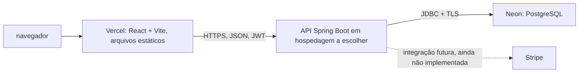

# Preparação para deploy

Este guia registra a configuração local preparada para uma futura publicação. Nenhuma conta externa foi conectada e nenhum deploy foi realizado. A API não tem hospedagem escolhida; os passos abaixo descrevem os contratos de configuração, não uma implantação concluída.

## Arquitetura prevista

- **Vercel** serve a SPA React. O frontend chama a API hospedada separadamente; CORS da API precisa permitir a origem pública da Vercel.
- **API** executa Java 21 / Spring Boot e as migrações Flyway. O Docker Compose continua sendo o ambiente local e não foi alterado.
- **Neon** fornece PostgreSQL gerenciado. Não há conexão remota configurada neste repositório.
- **Stripe** não processa pagamentos atualmente. As telas financeiras do frontend são demonstrações; a existência de propriedades e da biblioteca cliente não implementa checkout nem webhooks.

## Vercel: frontend

O app Vite fica em `web/`. O arquivo `web/vercel.json` define `npm run build`, a saída `dist` e o rewrite de SPA para que o React Router resolva URLs diretas. O build também executa `tsc -b`, portanto verifica os projetos TypeScript antes de gerar os arquivos estáticos.

Na configuração futura do projeto Vercel:

1. Importe o repositório e defina **Root Directory** como `web`.
2. Use Vite, Node.js 22.12 ou superior, instalação `npm ci`, build `npm run build` e saída `dist` (os dois últimos também estão no `vercel.json`).
3. Configure estas variáveis para os ambientes Preview e Production conforme necessário:

| Variável | Valor futuro | Observação |
|---|---|---|
| `VITE_DATA_MODE` | `api` | Faz a interface usar o backend; `mock` continua disponível para demonstrações locais. |
| `VITE_API_BASE_URL` | URL HTTPS pública da API seguida de `/api/v1` | É incorporada ao bundle e visível no navegador; só pode conter dados públicos. |

`API_PROXY_TARGET` serve somente ao proxy do Vite durante desenvolvimento local. Ele não configura proxy em produção. Como a API será outro serviço, use a URL HTTPS absoluta em `VITE_API_BASE_URL`; uma URL relativa só funcionará se uma hospedagem futura configurar um proxy reverso.

Nunca coloque `JWT_SECRET`, credenciais do Neon ou segredos Stripe em variáveis `VITE_*`. A configuração CORS da API deve listar exatamente as origens Vercel usadas (Production e, se necessário, Preview), separadas por vírgulas e sem espaços extras. O código atual compara origens exatas.

## Neon: PostgreSQL

O perfil Spring `prod` usa variáveis obrigatórias para conectar ao banco:

| Variável | Uso |
|---|---|
| `DB_URL` | JDBC URL `jdbc:postgresql://<host-Neon>/<database>`; não inclua usuário ou senha nela. |
| `DB_USERNAME` | Nome da role PostgreSQL criada para a API/migrações. |
| `DB_PASSWORD` | Senha dessa role, guardada como secret na hospedagem da API. |

Obtenha host, database, role e senha no painel Neon e monte a JDBC URL a partir do endpoint mostrado. O perfil `prod` força `sslmode=verify-full` no driver PostgreSQL: a conexão exige TLS e verifica certificado e hostname. Isso é mais estrito que apenas criptografar o tráfego. A aplicação local continua usando a URL local definida em `application.yml`.

Flyway permanece habilitado e executa V1–V8 na inicialização. Hibernate continua com `ddl-auto: validate`: depois das migrações, confere se o mapeamento Java corresponde ao schema, sem criar nem atualizar tabelas. Use primeiro uma branch/banco vazio de teste; não aponte a API para um banco com dados importantes durante a validação inicial. O papel configurado precisa ter permissões para as migrações e para as operações normais da API.

O datasource Spring é compartilhado pelo Hibernate e Flyway, então ambos recebem as mesmas opções TLS e credenciais. Prefira inicialmente o endpoint direto do Neon; antes de usar o endpoint pooled, valide a inicialização concorrente de múltiplas instâncias e as necessidades de lock do Flyway. Ajuste limites do pool de conexões somente após escolher a hospedagem e conhecer os limites do compute Neon.

## API: ambiente de produção

O Dockerfile da API passa a usar `prod` como perfil padrão da imagem. O `compose.yml` existente seleciona explicitamente `dev`, portanto preserva o uso local, seed e banco Docker. Em uma hospedagem que não use essa imagem, defina explicitamente `SPRING_PROFILES_ACTIVE=prod`.

Variáveis necessárias ou relevantes para iniciar a API em produção:

| Variável | Necessidade |
|---|---|
| `SPRING_PROFILES_ACTIVE` | `prod`; padrão da imagem Docker. |
| `DB_URL`, `DB_USERNAME`, `DB_PASSWORD` | Obrigatórias pelo perfil `prod`; veja seção Neon. |
| `JWT_SECRET` | Obrigatória; use um segredo aleatório forte com pelo menos 32 bytes, guardado no secret manager. O validador rejeita o segredo local e alguns padrões conhecidos em `prod`. |
| `CORS_ORIGINS` | Obrigatória; origens HTTPS do frontend, sem curingas. |
| `PORT` | Opcional; porta HTTP fornecida pela hospedagem; o padrão local é 8081. |
| `SEED_DEMO` | Não habilite em produção. O perfil `prod` define o seed como desativado. |
| `ADMIN_BOOTSTRAP_ENABLED` | Deixe desativado; habilite apenas num procedimento de provisionamento controlado e retire as credenciais depois. |

Não inclua valores de segredos neste arquivo nem em exemplos versionados. Configure-os no ambiente/secrets da hospedagem escolhida. A hospedagem ainda precisa oferecer runtime Java 21 ou executar o Dockerfile, health check para `/actuator/health`, porta HTTP dinâmica e rede de saída para o Neon.

## Stripe: somente preparação

O `application.yml` já declara `STRIPE_SECRET_KEY` e `STRIPE_WEBHOOK_SECRET`; `PUBLIC_APP_URL` foi declarado como URL pública futura para redirecionamentos. A dependência oficial `stripe-java` foi adicionada ao Maven para a etapa de integração. Nenhum código atual consome essas propriedades ou a biblioteca.

Ainda não existem endpoint de criação de checkout, modelo persistente de pagamento, endpoint receptor de webhook, validação da assinatura do webhook, política de idempotência ou reconciliação de estados. Portanto:

- Não cadastre uma URL de webhook Stripe ainda: não há endpoint implementado para receber eventos.
- Não configure `STRIPE_SECRET_KEY`, `STRIPE_WEBHOOK_SECRET` ou `PUBLIC_APP_URL` como se isso ativasse pagamentos.
- A interface atual continua simulando pagamentos e não deve ser apresentada como apta a cobrar ou confirmar transações reais.

Quando a implementação for aprovada, obtenha as chaves do ambiente de teste em **Stripe Dashboard → Developers → API keys**. O segredo de assinatura é específico de cada webhook e fica em **Developers → Webhooks**, não é a chave da API. Configure credenciais de teste e produção separadamente nos ambientes da hospedagem; mantenha qualquer chave secreta somente no backend. O frontend não precisa de chave publicável enquanto não integrar Stripe.js/Elements.

A biblioteca cliente está pronta para uso futuro, mas a escolha de Checkout, Payment Intents, Connect/repasse, eventos de webhook e estados financeiros exige decisão de produto e implementação/testes próprios antes de ativar credenciais.

## Sequência futura de publicação

1. Escolher e provisionar Neon; testar migrations numa branch vazia e conferir acesso TLS.
2. Escolher hospedagem da API, configurar perfil `prod`, secrets, CORS, health check e conectividade ao Neon; validar o modo de inicialização único/múltiplas instâncias e o job agendado de prazos.
3. Criar o projeto Vercel com root `web`, configurar variáveis públicas e publicar primeiro um Preview apontando para uma API de teste.
4. Verificar rotas profundas da SPA, autenticação, CORS e fluxos não financeiros; pagamentos permanecem simulados.
5. Só depois de implementar e testar o fluxo de pagamento/webhook, configurar Stripe em ambiente de teste. Ativação do modo real requer validação operacional e de negócio separada.
6. Promover os ambientes Production somente após revisão, backups, observabilidade, limites de conexão, política de dados e roteiro de rollback.

## Referências oficiais

- [Vite na Vercel: SPA e deep links](https://vercel.com/docs/frameworks/frontend/vite) e [configuração de build/root directory](https://vercel.com/docs/builds/configure-a-build).
- [Conexão Neon de aplicações e SSL](https://neon.tech/docs/connect/connect-from-any-app) e [segurança com `verify-full`](https://neon.tech/docs/connect/connect-securely).
- [Biblioteca oficial Stripe Java](https://github.com/stripe/stripe-java) e [chaves, webhooks e separação de teste/produção](https://docs.stripe.com/keys).
