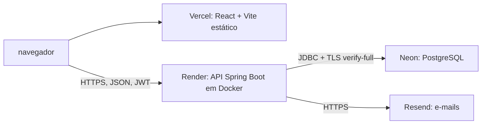

# Deploy: Vercel, Render, Neon e Resend

Revisado em **14/11/2026**. O repositório está pronto para publicar. Nenhuma conta externa foi conectada e nenhum deploy foi feito: os passos abaixo dependem das contas da equipe. Pagamentos (Stripe, F09) ficam para a última etapa e não fazem parte deste roteiro.

## Arquitetura



| Peça | Onde | Arquivo de configuração |
|---|---|---|
| Frontend | Vercel, root `web` | `web/vercel.json` |
| API | Render, Docker, plano free, região Virginia (ADR26) | `render.yaml`, `api/Dockerfile`, `application-prod.yml` |
| Banco | Neon, região `aws-us-east-1` | variáveis `DB_*` no Render |
| E-mail | Resend | variáveis `RESEND_*` no Render |

O navegador chama a API direto (CORS). A Vercel só serve os arquivos estáticos.

## Ordem recomendada

1. Neon: criar o banco.
2. Resend: criar a chave e, se possível, verificar o domínio.
3. Render: criar a API pelo Blueprint e preencher os segredos.
4. Vercel: criar o projeto do frontend apontando para a API.
5. Voltar ao Render e conferir `CORS_ORIGINS` e `PUBLIC_APP_URL` com a URL final da Vercel.
6. Criar o primeiro admin (seção própria) e testar o roteiro de verificação.

## 1. Neon

1. Crie um projeto na região **AWS US East 1 (N. Virginia)**, a mesma família de região do Render (ADR26).
2. Em **Connection Details**, escolha o endpoint **direto** (sem `-pooler` no host). O Flyway roda as migrações na inicialização e usa locks de sessão, que o pooler em modo transação não garante.
3. Monte a JDBC URL a partir do host e do banco mostrados, **sem usuário e senha**:

   ```text
   jdbc:postgresql://<host-do-endpoint>.neon.tech/<banco>
   ```

4. Guarde usuário e senha da role para o Render (`DB_USERNAME`, `DB_PASSWORD`).

Não acrescente `sslmode` na URL. O perfil `prod` já força `sslmode=verify-full` e `sslfactory=org.postgresql.ssl.DefaultJavaSSLFactory`: a conexão exige TLS e confere certificado e hostname usando o trust store da JVM, que já reconhece a autoridade do Neon. Esse caminho foi testado com um Postgres TLS local: certificado não confiável é recusado; certificado confiável sobe a API e aplica V1–V13.

O plano free suspende o compute ocioso; a primeira conexão depois de uma pausa leva alguns segundos (o pool espera até 30 s). As fotos ficam no próprio banco (ADR21), então acompanhe o limite de armazenamento do plano.

## 2. Resend

1. Crie uma API key com permissão de envio (`RESEND_API_KEY`).
2. Para enviar a qualquer destinatário, verifique um domínio próprio em **Domains** e use um remetente desse domínio, por exemplo `FreeLanceNow <no-reply@seu-dominio>` (`RESEND_FROM_EMAIL`).
3. Sem domínio verificado, o padrão do perfil `prod` é `onboarding@resend.dev`, que o Resend só entrega para o e-mail dono da conta Resend. Serve para teste, não para usuários reais.

A API envia confirmação de cadastro (`/verificar-email`, 24 h, ADR25), redefinição de senha (`/redefinir-senha`, 30 min) e cópias dos avisos importantes (ADR28), todos com links baseados em `PUBLIC_APP_URL`. No plano gratuito do Resend, acompanhe a cota diária de envios. Sem `RESEND_API_KEY`, a API sobe, registra um aviso e não envia nada.

## 3. Render (API)

1. No Render, **New → Blueprint** e selecione este repositório. O `render.yaml` cria o serviço `freelancenow-api` com Docker (`rootDir: api`), health check em `/actuator/health`, deploy automático só quando `api/**` muda e `JWT_SECRET` gerado pelo próprio Render.
2. Preencha os valores pedidos (marcados `sync: false`):

| Variável | Valor |
|---|---|
| `DB_URL` | JDBC URL do Neon (passo 1) |
| `DB_USERNAME`, `DB_PASSWORD` | Role do Neon |
| `CORS_ORIGINS` | Origem da Vercel, ex. `https://freelancenow.vercel.app`. Várias origens separadas por vírgula, sem espaço e sem barra final |
| `PUBLIC_APP_URL` | A mesma origem da Vercel; vira a base dos links dos e-mails. Obrigatória no `prod` |
| `RESEND_API_KEY` | Chave do passo 2 |
| `RESEND_FROM_EMAIL` | Remetente do domínio verificado; vazio usa `onboarding@resend.dev` |

3. Já definidas no Blueprint: `SPRING_PROFILES_ACTIVE=prod`, `JAVA_TOOL_OPTIONS` ajustado para 512 MB, `ADMIN_BOOTSTRAP_ENABLED=false`. O Render injeta `PORT`, que a API já lê.
4. Depois do deploy, `https://<servico>.onrender.com/actuator/health` deve responder `{"status":"UP"}`.

Medido localmente com o perfil `prod`, 512 MB e as mesmas opções de JVM: inicialização em cerca de 4 s e uso perto de 270 MB. No Render free a primeira inicialização é mais lenta.

**Hibernação.** O plano free dorme após 15 minutos sem tráfego. O primeiro acesso depois disso pode levar até um minuto. A verificação de prazos (cancelar pendentes após 48 h, confirmar conclusão após 5 dias) só roda com a instância acordada; ao acordar, ela processa tudo o que venceu, porque compara datas em vez de depender do horário exato. Para uma demonstração sem espera, abra o health check alguns minutos antes ou use um plano pago.

O seed de demonstração fica desligado em produção. Para ligá-lo numa apresentação, veja a seção 5.1.

## 4. Vercel (frontend)

1. **Add New → Project**, importe o repositório e defina **Root Directory** como `web`. O `web/vercel.json` já define framework Vite, `npm ci`, `npm run build`, saída `dist`, rewrite de SPA, cache longo para `/assets` e cabeçalhos básicos de segurança.
2. Variáveis de ambiente (Production e, se usar, Preview):

| Variável | Valor |
|---|---|
| `VITE_DATA_MODE` | `api` |
| `VITE_API_BASE_URL` | `https://<servico>.onrender.com/api/v1` |
| `VITE_SUPPORT_EMAIL` | Opcional; contato exibido em Ajuda, Termos e Privacidade |

Variáveis `VITE_*` entram no bundle e ficam visíveis no navegador. Nunca coloque nelas `JWT_SECRET`, credenciais do Neon ou chaves do Resend.

3. Depois do primeiro deploy, copie a URL de produção para `CORS_ORIGINS` e `PUBLIC_APP_URL` no Render. Previews da Vercel têm outra origem: inclua-a em `CORS_ORIGINS` só se for usar o Preview contra esta API.

### Backup e restauração

O Neon guarda histórico para restauração em um ponto no tempo (a janela depende do plano). Antes de uma demonstração ou mudança grande, crie uma **branch** do banco no painel: ela é uma cópia instantânea que pode virar o banco da API se algo der errado (troque `DB_URL` para o host da branch). Para uma cópia fora do Neon, use `pg_dump` com a URL de conexão direta. Teste a restauração numa branch, nunca sobre o banco em uso.

## 5. Primeiro administrador

Não existe admin padrão (ADR16). Para criar o primeiro:

1. No Render, defina temporariamente `ADMIN_BOOTSTRAP_ENABLED=true`, `ADMIN_BOOTSTRAP_EMAIL`, `ADMIN_BOOTSTRAP_PASSWORD` (senha forte) e, se quiser, `ADMIN_BOOTSTRAP_NAME`.
2. Faça o deploy e entre com essa conta.
3. Volte `ADMIN_BOOTSTRAP_ENABLED` para `false` e **apague** `ADMIN_BOOTSTRAP_PASSWORD`. Reinícios não recriam nem alteram a conta.

## 5.1 Dados de demonstração (opcional)

Para apresentar o projeto com conteúdo, a API pode criar as mesmas contas e atividades do ambiente local (8 contas em `demo.freelancenow.test`, 10 anúncios, demandas, contratações com avaliações, um chat e posts no feed; lista em `docs/contas-desenvolvimento.md`).

1. No Render, defina `SEED_DEMO=true` e `SEED_DEMO_PASSWORD` com uma senha nova, de pelo menos 8 caracteres. No `prod` não existe senha padrão: sem `SEED_DEMO_PASSWORD` o seed não roda e registra um aviso no log. Não use `Demo12345`, que está no repositório.
2. Salve e espere o novo deploy. As contas são criadas na inicialização; reinícios não duplicam nada nem trocam a senha de contas que já existem.
3. Entre com `ana@demo.freelancenow.test` ou `marcos@demo.freelancenow.test` e a senha escolhida.
4. Depois da apresentação, volte `SEED_DEMO` para `false` e apague `SEED_DEMO_PASSWORD`. Para tirar as contas do ar, desative-as pelo painel de administração.

Os endereços `.test` são reservados (RFC 2606) e nunca recebem e-mail, por isso `ResendMailSender` descarta mensagens para eles em vez de chamar o Resend. Avisos dentro do app continuam normais.

## 6. Verificação depois do deploy

- Abrir uma rota profunda direto (ex. `/servicos`) e recarregar: a SPA deve responder sem 404.
- Cadastrar um cliente: o e-mail de confirmação chega, o link abre `/verificar-email` e o aviso do topo some.
- Pedir redefinição de senha e concluir pelo link do e-mail.
- Publicar um anúncio com foto como profissional, solicitar como cliente, aceitar, iniciar, concluir, confirmar e avaliar.
- Entrar como admin: usuários, moderação, relatórios e auditoria.
- No console do navegador, nenhum erro de CORS. Até a correção do bean `corsConfigurationSource` (15/11) a API não enviava cabeçalhos CORS; o proxy do Vite escondia isso localmente.
- Errar a senha mais de 20 vezes em um minuto retorna "Muitas tentativas".
- Nos logs do Render, cada linha é um JSON com `requestId`. Para investigar um erro relatado com "Código do erro", busque esses 8 caracteres nos logs.

## Variáveis por ambiente

| Variável | Onde | Obrigatória no `prod` |
|---|---|---|
| `SPRING_PROFILES_ACTIVE` | Render | Sim (`prod`, já no Blueprint e no Dockerfile) |
| `DB_URL`, `DB_USERNAME`, `DB_PASSWORD` | Render | Sim |
| `JWT_SECRET` | Render | Sim (gerado; pelo menos 32 bytes; o validador recusa os valores de exemplo) |
| `CORS_ORIGINS`, `PUBLIC_APP_URL` | Render | Sim |
| `RESEND_API_KEY` | Render | Não, mas sem ela nenhum e-mail sai |
| `RESEND_FROM_EMAIL` | Render | Não (padrão `onboarding@resend.dev`) |
| `DB_POOL_SIZE` | Render | Não (padrão 5) |
| `AUTH_RATE_LIMIT_PER_MINUTE` | Render | Não (padrão 20 no `prod`; 0 desliga) |
| `JWT_REFRESH_TTL_SECONDS` | Render | Não (padrão 30 dias) |
| `ADMIN_BOOTSTRAP_*` | Render | Só no provisionamento do primeiro admin |
| `SEED_DEMO`, `SEED_DEMO_PASSWORD` | Render | Não (só para apresentações; seção 5.1) |
| `VITE_DATA_MODE`, `VITE_API_BASE_URL` | Vercel | Sim |
| `VITE_SUPPORT_EMAIL` | Vercel | Não |

Valores de exemplo ficam em `.env.example` e `web/.env.example`. Segredos reais ficam só nos painéis do Render e da Vercel.

## Pagamentos (F09, depois)

No modo API, as telas de carteira, pagamento, saque e transações mostram "Em breve" e saem do menu (ADR27). As tabelas `payment` e `ledger_entry` (V10) e a dependência `stripe-java` já existem, mas não há checkout, webhook nem reconciliação. Não configure `STRIPE_SECRET_KEY` nem cadastre webhook antes dessa implementação.

O que pode ser preparado desde já, sem tocar no deploy:

1. Criar a conta Stripe e ficar no **modo de teste** (sandbox). Nenhum dado bancário é necessário para testar.
2. Em **Developers → API keys**, anotar a chave secreta de teste (`sk_test_...`) num gerenciador de senhas. Ela só vai para o Render quando o F09 existir, como `STRIPE_SECRET_KEY`.
3. Instalar a Stripe CLI para testar webhooks localmente (`stripe listen --forward-to localhost:8081/...`) quando o endpoint existir.

Quando o F09 estiver pronto, o roteiro de deploy ganha: `STRIPE_SECRET_KEY` e `STRIPE_WEBHOOK_SECRET` no Render (`sync: false` no Blueprint), um webhook em **Developers → Webhooks** apontando para a URL pública da API e o teste de um pagamento com o cartão de teste `4242 4242 4242 4242`. Chaves `sk_live_` só depois da ativação da conta e de uma revisão do fluxo.

## Referências oficiais

- [Render Blueprints](https://render.com/docs/blueprint-spec), [Docker no Render](https://render.com/docs/docker) e [plano free](https://render.com/docs/free).
- [Neon: conexão de aplicações](https://neon.tech/docs/connect/connect-from-any-app) e [conexão segura](https://neon.tech/docs/connect/connect-securely).
- [Resend: domínios](https://resend.com/docs/dashboard/domains/introduction) e [API de envio](https://resend.com/docs/api-reference/emails/send-email).
- [Vite na Vercel](https://vercel.com/docs/frameworks/frontend/vite) e [configuração de build](https://vercel.com/docs/builds/configure-a-build).
